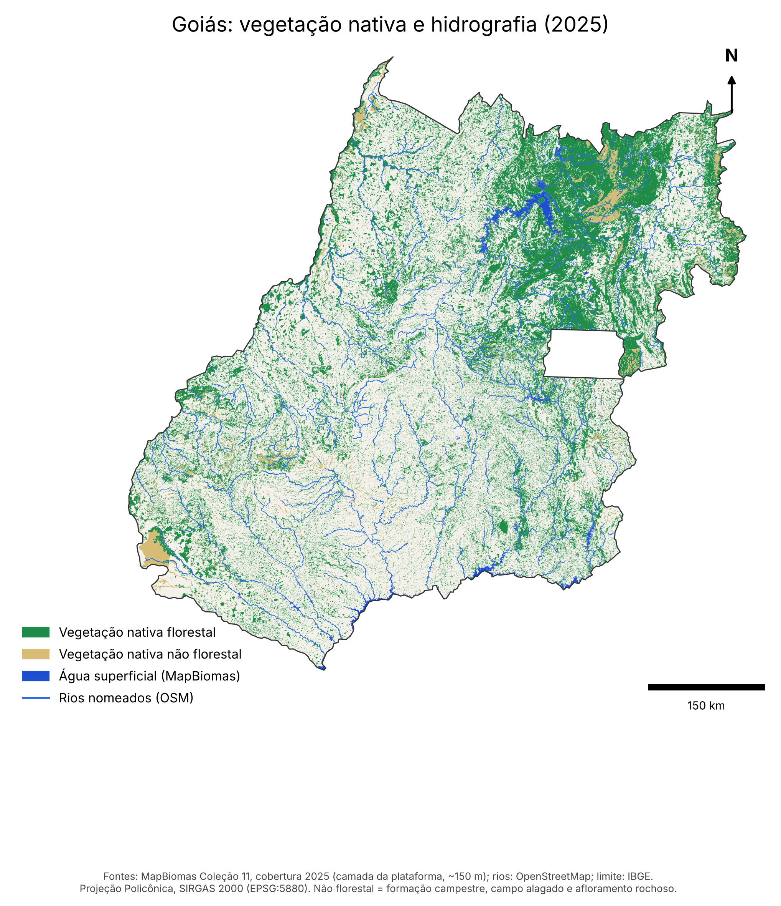

# Goiás: vegetação nativa e hidrografia (2025)

Mapa e camadas de vegetação nativa, água superficial e rios de Goiás, montados em 22/10/2026 (Squad 1, Estudante 1).

## Fontes

| Camada | Fonte | Observação |
|---|---|---|
| Vegetação nativa e água superficial | **MapBiomas — Coleção 11, cobertura e uso da terra de 2025** (https://brasil.mapbiomas.org) | Camada da plataforma do MapBiomas, em resolução de ~150 m (o dado original é de 30 m) |
| Rios nomeados | **OpenStreetMap** (https://www.openstreetmap.org) | Só rios com nome; comprimento em km na coluna `comp_km` |
| Limite do estado | **IBGE** — malha estadual | Código `52` |

Fontes como impressas no próprio mapa (PDF). Licenças: MapBiomas, CC BY 4.0; OpenStreetMap, ODbL (exige atribuição "© colaboradores do
OpenStreetMap" em qualquer uso público).

## Conteúdo

`mapa_goias_2025.zip` (45 MB, 218 MB descompactado), como foi montado:

| Arquivo | O que é |
|---|---|
| `mapa_goias_vegetacao_rios_2025.pdf` / `.png` | o mapa (projeção Policônica, SIRGAS 2000, EPSG:5880) |
| `shapefile/vegetacao_nativa_goias_2025` | 139.030 polígonos de vegetação nativa, `tipo` (florestal ou não florestal) e `area_ha` |
| `shapefile/agua_superficial_goias_2025` | 1.820 polígonos de rio, lago e reservatório (classe 33 do MapBiomas) |
| `shapefile/rios_goias` | 346 rios nomeados (OSM), com `nome` e `comp_km` |
| `shapefile/limite_goias` | limite estadual (IBGE) |
| `vegetacao_nativa_goias_2025.geojson`, `agua_superficial_goias_2025.geojson`, `rios_goias.geojson` | as mesmas camadas em GeoJSON |
| `pontos_cobertura_nativa_agua_goias_2025.csv` | 111.348 pontos (`lon`, `lat`, `classe_mapbiomas`, `nome`) amostrados da camada do MapBiomas |
| `area_por_classe_goias_2025.csv` | área e % do estado por classe (cópia solta aqui ao lado) |

Shapefiles e GeoJSON em SIRGAS 2000 geográfico, UTF-8 (com `.cpg`). "Não florestal" = formação campestre, campo alagado e afloramento
rochoso.

O zip fica inteiro porque o GeoJSON da vegetação (123 MB) passa do limite de 100 MB por arquivo do GitHub. Por ser derivado de uma camada
reamostrada (~150 m), serve para mapa e visão geral do estado; para área por município ou análise fina, use o dado de 30 m do MapBiomas.
